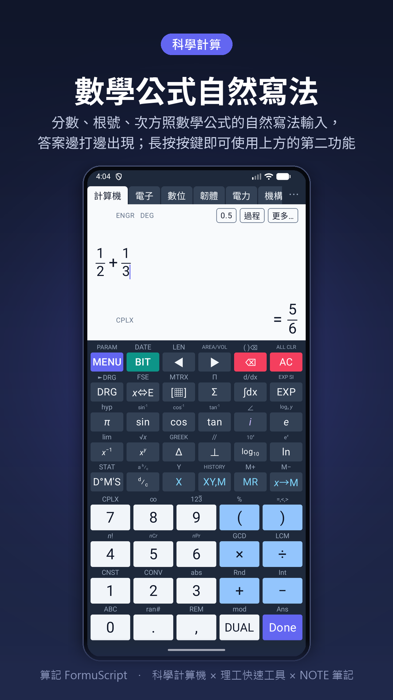
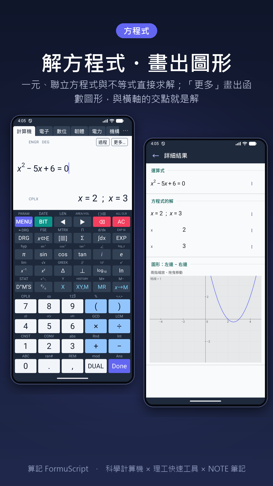
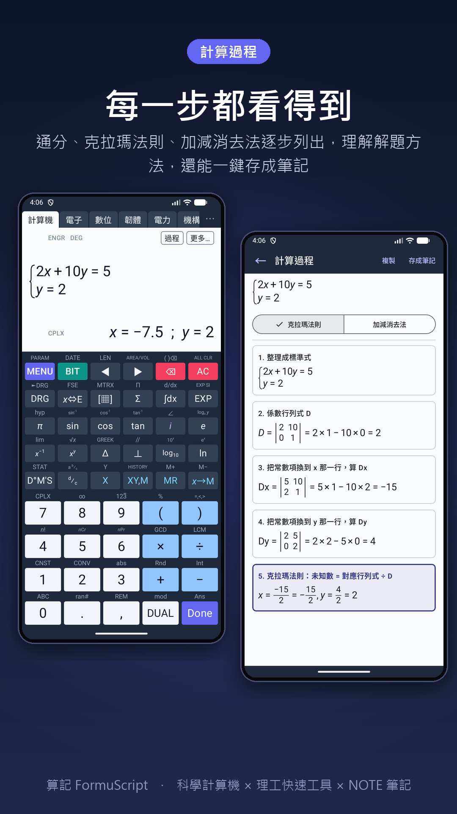
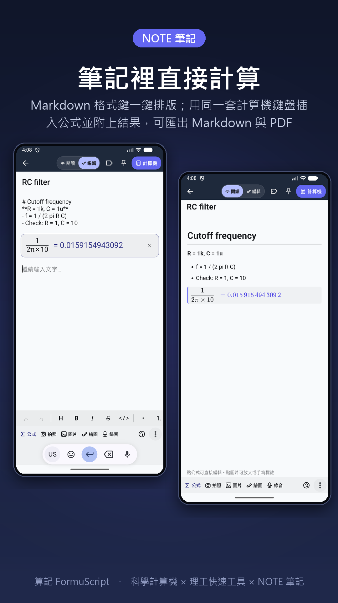
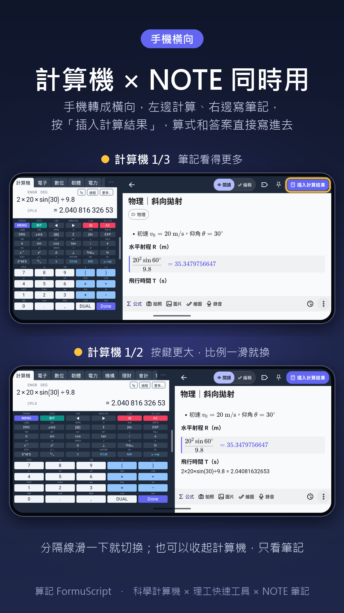

**算記（FormuScript）** 是一個把「科學計算機」、「224 個理工快速工具」和「可以直接計算的筆記」放在一起的 Android App。適合理工學生、工程師和寫程式的人：算完的東西不用再抄一次，直接留在筆記裡。

這篇用 5 個小練習，帶你認識最常用的功能。

## 1. 照數學公式的寫法輸入

算記的算式是「自然書寫」：分數就是上下兩層，根號、次方也跟課本上看到的一樣。

試著算 ½ + ⅓：

`d/c` `1` `▶` `2` `▶` `+` `d/c` `1` `▶` `3`

答案 **5/6** 會**邊打邊出現**在右下角，不必先按等號。

> **兩個新手一定要知道的小技巧**
>
> - **`▶` 跳出格子**：分數、次方、根號這類有格子的算式，打完格子裡的數字要按 `▶` 才會跳出來。
> - **長按 = 第二功能**：每個按鍵上方的灰色小字就是它的第二功能，直接**長按**那個鍵就能用。

## 2. 解方程式，順便畫出圖形

解 x² − 5x + 6 = 0：

1. 輸入左邊：`X` `xʸ` `2` `▶` `−` `5` `X` `+` `6`
2. **長按 `)`**（上方小字是 `=,<,>`），選「等於」
3. 輸入 `0`，按 `=`

答案是 **x = 2、x = 3**。再按上方的「**更多…**」，就能看到函數圖形：曲線和橫軸的兩個交點，就是這兩個解。圖形可以用兩指縮放、拖曳移動。

算記也能解不等式，以及 2～4 個未知數的聯立方程式。

## 3. 看每一步怎麼算

算完之後按上方的「**過程**」，算記會把解題步驟一步步列出來，例如分數的通分、聯立方程式的克拉瑪法則與加減消去法。

寫作業時想確認自己哪一步算錯，或想知道解法怎麼來的，這裡最好用。過程也可以**一鍵存成筆記**。

## 4. 把計算寫進筆記

在計算機畫面**往左滑**，就會進入 NOTE 筆記。

- 上方的 Markdown 格式鍵可以一鍵加上標題、粗體、清單、待辦和表格。
- 點「**公式**」會出現跟計算機一樣的鍵盤：輸入算式後按 `=`，算式和答案會一起插入筆記。
- 之後點一下筆記裡的公式，就能再修改。
- 筆記可以加照片、圖片、手寫和錄音，也能匯出成 Markdown 或 PDF。

記完之後按右上角的「**計算機**」，就會回到剛才的計算畫面，原本的算式都還在。

## 5. 手機轉橫向：左邊算、右邊記

把手機轉成橫向，畫面會分成兩半：左邊是計算機，右邊是筆記。算完按「**插入計算結果**」，算式和答案就會直接寫進右邊的筆記（需要 1.2.8 以上的版本）。

平板則是直向、橫向都能讓計算機和筆記左右並排。

## 免費版與專業版

- **免費版**含廣告。科學計算、計算過程、單位換算和日期計算都能直接使用。
- 矩陣、微積分、統計、複數、方程式、BIT 位元計算、物理常數、快速工具和筆記裡的公式輸入，**每天可以免費使用 20 分鐘**；時間用完可以看一段廣告，再增加 20 分鐘。
- **專業版**是一次買斷，沒有訂閱：沒有廣告、進階功能不限時間，自訂工具與公式也不設上限。

在 App 的「設定」裡，可以看到兩者完整的差異。

## 接下來

這篇只介紹了最基本的操作。之後的教學會再介紹：

- 224 個理工快速工具：填入已知值，馬上算出答案
- BIT 位元計算：HEX、DEC、OCT、BIN 同步換算
- 工程師模式與 DUAL 雙螢幕
- 筆記的匯出、備份與還原
